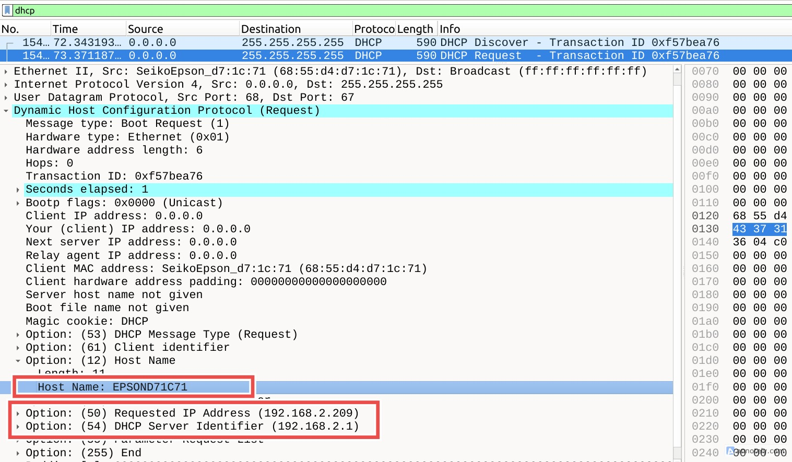
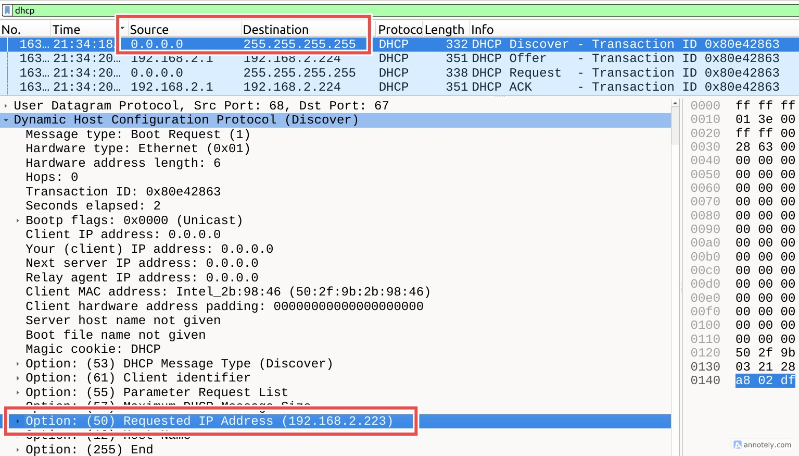
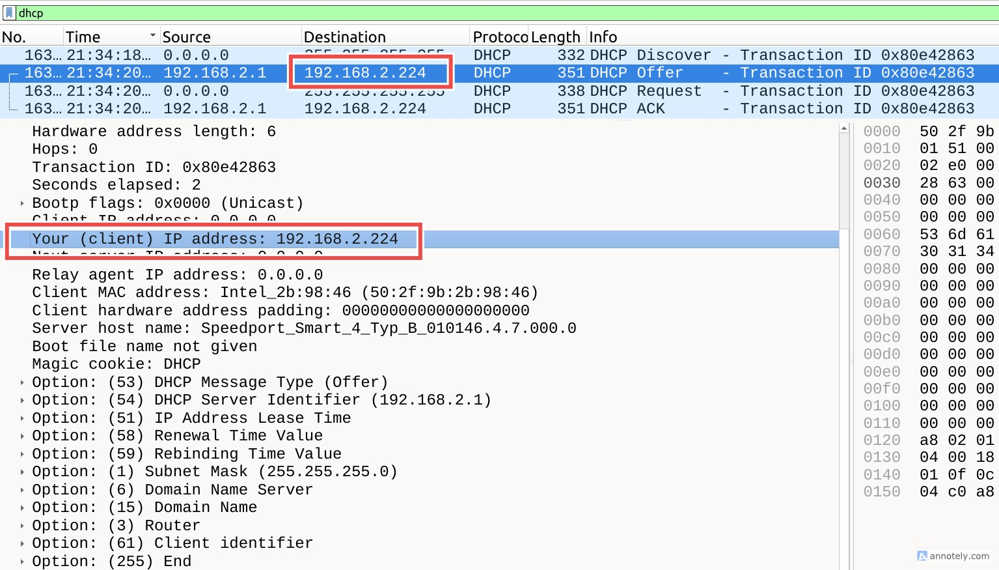

+++
title = 'DHCP, or the magic of network discovery'
date = 2026-03-07T07:07:07+01:00
draft = false
+++

Last Christmas I treated myself to a heavy 800-page book on networking fundamentals and I've been meticulously "plowing" through it ever since. And boy am I taking my sweet time with it: looking up references or RFCs along the way and letting myself be nerd-sniped into building my very own DNS server from scratch (one day, I'll finish it, I promise). Or simply launching Wireshark and just observing. What can I say, it's a journey.

Each weekend, when I wake up, I make myself some coffee, go back to bed and pick up this monster of a book. Oh how I enjoy these mornings. I've been making notes on what fascinates me along the way but haven't gathered courage (and discipline) to write down my thoughts properly. This is an attempt... :)

## DHCP

[DHCP](https://en.wikipedia.org/wiki/Dynamic_Host_Configuration_Protocol) (short for Dynamic Host Configuration Protocol) is a network discovery protocol, allowing new hosts joining a network to request an IP address within this network. It's a simple client-server model which automates the process of IP allocation and network configuration for a new device on the network. Imagine having to configure it manually each time you connect to Wi-Fi in your local coffee shop, a library or an office. And not even that, you'd have to talk to a network administrator for them to register the new host on the network under a certain IP address so that devices on the network can actually reach you. Hard to imagine a scenario like this in such a mobile world we live in.

Let's now think how DHCP would work in practice. When a new host joins a network, it has no IP, knows no subnet mask or DNS server address and has no routing information. It broadcasts a DHCP discovery message via UDP with destination port 67 to `255.255.255.255`. The DHCP server responds with an offer containing an IP address. The original host can now request this address by broadcasting another DHCP message, upon which the server responds with an ACK. Only then the host and the server updates their respective network configurations. The discovery-offer-request-aknowledgement (DORA) cycle is also referred to as a 4-way handshake.

Some, if not most part of DORA is broadcast, which I found an interesting design choice. This is why, for example, I could see DHCPREQUEST messages in Wireshark without actually initiating any request from my machine. I was confused at first before I realized that each IP "lease" has a TTL, after which the allocated IP will be released. If the host intends on keeping it, it has to request extension which is (surprise-surprise) also broadcast. That's how I could witness my scanner, for example, requesting to extend its "lease" in my home network :)



## Initiating a DHCP communication

Naturally, I wanted to see how it works in action. I reactivate my connection to my home network:

```
nmcli connection down "My Beloved Network" && nmcli connection up "My Beloved Network"
```

What I observe in Wireshark is confusing, though. My host broadcast a discovery message requesting lease extension for IP `192.168.2.223`. Note the source IP `0.0.0.0` and the destination `255.255.255.255`, as expected. So far so good, no surprises here.



The addressing of the server response, though, is extremely confusing. It offers `192.168.2.224` but contrary to my expectations, the message wasn't broadcast. Instead, it was sent directly to my host with the destination IP being the very same one that's being offered. How is it possible, if my host has no IP address assigned at the moment? How can the packet addressed to the proposed IP reach me? So many questions.



I could observe the same pattern with the rest of the DHCP cycle: my host requesting the offered IP by boradcasting the message and the server ACKnowledging it with a unicast message. The network configuration is now updated on both my machine and the DHCP server.

I dug around. Turns out, the broadcast mode of server responses is controlled by a flag set in the initial client discovery message. Some OSs don't support unicast messages before the IP configuration is complete, in which case the DHCP server broadcasts its responses. Apparently, my host is capable of more effecient communication, which is why it set the flag in its discovery message to signal that it supports unicast. One mystery solved. It still doesn't explain though how the server responses can reach me with the nonsencical destination IP while my host remains "unaddressable".

The explanation is actually straightforward: DHCP messages are delivered as link-layer frames, not as fully routable IP packets. The addressee is reached by its MAC address while the destination IP plays the humble role of a placeholder in this context. When the DHCP server receives a discovery message, it reads the broadcast flag (which tells it whether the client can handle unicast) and extracts the client's MAC address. If unicast is allowed, the server sends a link-layer frame directly to that MAC, placing the offered IP in the destination IP header. When the NIC on the host receives the Ethernet frame, it passes it up the network stack to the network layer. Normally, the IP layer checks the destination IP against the host’s configured IP and drops or routes the packet if it doesn’t match. DHCP is a special case: the packet is accepted and passed to UDP port 68, even though the host doesn’t yet have the offered IP. This allows the DHCP client to process OFFER and ACK messages safely before the OS has configured the interface.

So what looks like your IP "changing before the lease is granted" is just link-layer delivery bypassing the usual IP checks. Mystery solved!

Journalctl logs for the Network Manager service:

```bash
❯ journalctl -u NetworkManager.service \
    --since "2026-03-07 21:34:00" \
    --until "2026-03-07 21:40:00"
device (wlp4s0): ip:dhcp4: restarting
dhcp4 (wlp4s0): canceled DHCP transaction
dhcp4 (wlp4s0): activation: beginning transaction (timeout in 45 seconds)
dhcp4 (wlp4s0): state changed no lease
dhcp4 (wlp4s0): activation: beginning transaction (timeout in 45 seconds)
device (wlp4s0): ip:dhcp6: restarting
dhcp6 (wlp4s0): canceled DHCP transaction
dhcp6 (wlp4s0): activation: beginning transaction (timeout in 45 seconds)
dhcp6 (wlp4s0): state changed no lease
dhcp6 (wlp4s0): activation: beginning transaction (timeout in 45 seconds)
device (wlp4s0): supplicant interface state: completed -> authenticating
device (p2p-dev-wlp4s0): supplicant management interface state: completed -> authenticating
device (wlp4s0): supplicant interface state: authenticating -> associating
device (p2p-dev-wlp4s0): supplicant management interface state: authenticating -> associating
device (wlp4s0): supplicant interface state: associating -> associated
device (p2p-dev-wlp4s0): supplicant management interface state: associating -> associated
device (wlp4s0): supplicant interface state: associated -> 4way_handshake
device (p2p-dev-wlp4s0): supplicant management interface state: associated -> 4way_handshake
device (wlp4s0): supplicant interface state: 4way_handshake -> completed
device (wlp4s0): ip:dhcp4: restarting
dhcp4 (wlp4s0): canceled DHCP transaction
dhcp4 (wlp4s0): state changed no lease
dhcp4 (wlp4s0): activation: beginning transaction (timeout in 45 seconds)
device (wlp4s0): ip:dhcp6: restarting
dhcp6 (wlp4s0): canceled DHCP transaction
dhcp6 (wlp4s0): state changed no lease
dhcp6 (wlp4s0): activation: beginning transaction (timeout in 45 seconds)
device (p2p-dev-wlp4s0): supplicant management interface state: 4way_handshake -> completed
dhcp6 (wlp4s0): state changed new lease
dhcp4 (wlp4s0): state changed new lease, address=192.168.2.224, acd pending
dhcp4 (wlp4s0): state changed new lease, address=192.168.2.224
```

## Concluding Thoughts

The information about the network is periodically re-requested by the host (be that after booting or after the IP lease expiry). I also noticed DHCP initiation after waking my machine from sleep. Our devices are in constant background communication which isn't related to the information we explicitly request, like when streaming a video or opening a web page. Yet this "background noise" ensures the host stays connected and stay up to date about the network it's connected. Isn't it fascinating?
